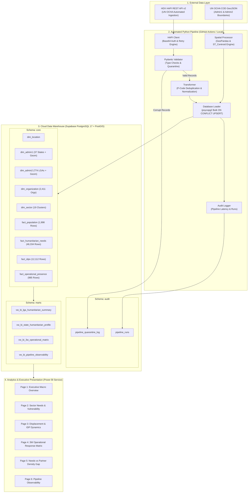

# Nigeria Humanitarian Intelligence Platform (N-HIP)
## System Architecture & Technical Specification

N-HIP is an automated, enterprise-grade humanitarian data intelligence platform designed for crisis monitoring in Nigeria. It automates data extraction from the United Nations OCHA Humanitarian Data Exchange (HDX HAPI), performs validation and PostGIS geospatial harmonization, stores structured facts in a Supabase PostgreSQL warehouse, and exposes analytical SQL marts to Power BI for executive decision-making.

---

## 1. High-Level Architecture Diagram

---

## 2. Key Architecture Pillars

### 1. Zero-Double-Counting Analytical Integrity
Humanitarian assessments often suffer from Cartesian multiplication when summing multi-sector demographics. N-HIP enforces strict filtering on the `INTERSECTORAL` cluster and pre-aggregated `category = 'total'` rows in `marts.vw_bi_lga_humanitarian_summary`, mathematically eliminating demographic double-counting.

### 2. Idempotent Data Loading
All loaders in `src/database/loader.py` utilize PostgreSQL `ON CONFLICT (...) DO UPDATE` statements bound to composite natural business keys (e.g. `admin2_code + sector_code + category + reference_period_start`). Running the ETL pipeline repeatedly results in zero data duplication.

### 3. Spatial Reference Harmonization
HDX HAPI provides P-codes but lacks vector polygons. N-HIP incorporates `src/geospatial/spatial_processor.py`, which maps official UN OCHA COD GeoJSON boundaries to `dim_admin1` and `dim_admin2` using fuzzy matching, providing 100% PostGIS polygon and centroid coverage for spatial choropleth mapping.

### 4. Fully Autonomous Cloud Execution
Configured with GitHub Actions (`.github/workflows/etl_daily_pipeline.yml`) to execute on a daily cron schedule (`02:00 UTC`), automatically pulling updates from HDX HAPI, validating records, and feeding the live Power BI executive dashboards.
